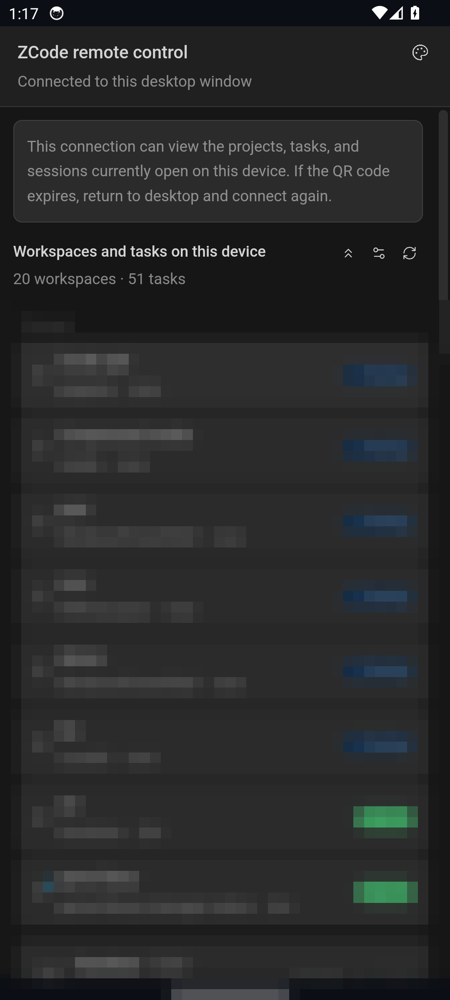
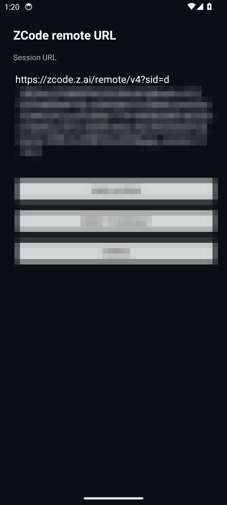
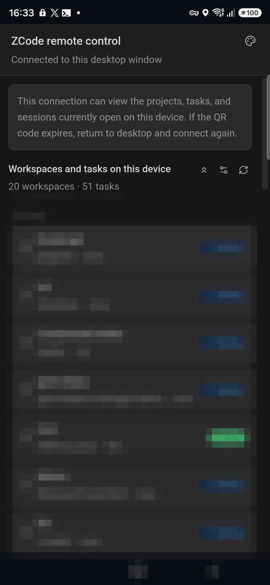

# ZCode — your ZCode remote session, as a native app

One tap from your launcher to your ZCode remote-control session, fullscreen — no browser, no address bar, no lost tabs. Instant resume, real-time progress even in the background, "Hey ZCode" voice wake-up, and full no-root control of the phone itself.

[](https://github.com/Michaelunkai/zcode-remote-app/releases)
[-green)](#requirements)
[](#license)


The ZCode desktop app generates a personal URL for remote control — something shaped like
`https://zcode.z.ai/remote/v4?sid=...&hash=...&t=...&mid=...&name=...&app_version=...`.
This app wraps that URL in a fullscreen, dark-themed WebView and behaves like a real app: launcher icon (a terminal `>_` glyph), no browser UI, and a session that stays alive.

## 📱 What it does

Open **ZCode** from your launcher and your remote session loads fullscreen — no address bar, no browser tabs, no accidental tab swipes. The screen stays awake while the app is open, so you can supervise a run on your PC from across the room.

| Live session | Settings |
|---|---|
|  |  |
| *Live session — the app fullscreen, task list pixelated for privacy* | *Change server URL screen* |

**Works even while the phone is locked** — the session renders and stays interactive *above* the secure lockscreen (the lock itself is never dismissed). The 🔒 in the status bar below is real:



## 🤔 Why

The remote URL is awkward in a browser:

- you have to retype it or dig it out of your desktop app every time,
- it drowns among your other tabs,
- one accidental tab closure drops the session.

The app pins it. One tap away, always the same URL, and the phone screen stays awake during remote supervision.

## ✨ Features

### Session (v1.0–v1.2)

- Fullscreen WebView session — zero browser UI
- Pull-to-refresh that never fights your scrolling — it only fires when the page **and every inner list** are at their very top; scrolling up inside a session never refreshes (v1.2.0)
- No overscroll glow/bounce at the edges — the page feels native, not browserish
- Distinctive adaptive icon (terminal-Z mark, violet cursor, gradient background, themed-icon support)
- In-page progress bar
- Back button walks web history, then **minimizes** (never kills the session)
- Keep-screen-on while the app is open
- **Works above the lockscreen** — session stays visible and interactive over the secure lock (never dismisses it); the screen wakes on launch (v1.1.0)
- Error screen with **Retry** / **Change URL** buttons when the session cannot load
- File upload through the system file picker
- Downloads routed through the system DownloadManager, with a "Download started" toast
- Share a URL from any app (Android share sheet) to load it in ZCode
- Launcher app shortcuts: **Change server URL**, **Device control**
- Survives rotation without reloading (configChanges handled)
- Session URL stored only in app-private storage

### Instant resume & real-time progress (v1.3.0)

- **Never "please refresh" again** — a keep-alive foreground service plus a renderer pinned at full priority keep the page (sessions menu, per-session progress, running tasks) fully alive while the app is minimized. Cold start ≈150 ms; returning to the app or switching session tabs lands on an already-live page in well under a second.
- **Self-healing connection** — if the network drops or the WebView renderer is killed by the system, the app rebuilds automatically and reloads the session the moment connectivity returns (capped backoff, no spinners).
- The keep-alive notification carries **Device panel** / **Stop** actions.

### Device control — no root (v1.3.0)

The **Device panel** (notification action, or long-press the launcher icon) is a native control surface for the phone itself — it keeps working even when the PC is offline:

- Global navigation: Back / Home / Recents / Notifications / Quick settings / Power dialog / Split screen / Lock screen
- Gestures: tap, long-press, swipe — anywhere on screen (accessibility gesture dispatch)
- Text input into any focused field
- Screenshots saved to `Pictures/Screenshots`
- Volume, media keys, flashlight, brightness
- App launcher (any installed app)
- **Wake-on-LAN** — wake the PC from full power-off (set the PC NIC's MAC in the panel; on the same network it just works, and from far away you can forward a UDP port on your router to the PC's subnet broadcast and use `public-ip:port`)
- An origin-guarded JS bridge (`window.ZcodeAndroid`) exposes the same powers to the loaded session page

One-time setup lives at the bottom of the panel: **Device control (accessibility)** must be enabled — everything else (battery exemption, modify-system-settings, overlay) has direct shortcuts. Two notes: Android revokes accessibility permission every time the app is **updated** (system security behavior) — one tap in the panel's setup row re-enables it; and the wake-word feature stays **off** unless you deliberately switch it on (its microphone row in Setup is intentionally left "—").

The panel also opens deterministically for automation: `adb shell am start -n com.michaelunkai.zcoderemote/.MainActivity --ez open_panel true`.

## 📋 Requirements

| Requirement | Value |
|---|---|
| Android | 8.0+ (API 26+) |
| Core permission | `INTERNET` |
| Optional (per feature) | accessibility service (device control), `WRITE_SETTINGS` (brightness), notification access |
| Analytics / tracking | None |
| Network calls | Loading your session URL + Wake-on-LAN UDP to the address you configure |
| Microphone / voice features | None — the app never touches the microphone |

## 📥 Install

1. Download `zcode-remote-v1.4.0.apk` from the [latest release](https://github.com/Michaelunkai/zcode-remote-app/releases/latest).
2. Android will ask you to allow installs from your browser/file manager (**Settings > Apps > Special access > Install unknown apps**). This APK is self-signed, sideloaded, and privacy-minimal.
3. Open **ZCode**.
4. Optional: long-press the icon → **Device control**, and walk the setup rows at the bottom of the panel.

> The release APK already has the owner's session URL embedded. If none is embedded (a build from source without `remote.properties`), the app opens the URL settings screen on first launch.

## 🚀 Usage

- Open **ZCode** from the launcher — the session loads fullscreen.
- Refresh: pull down (only when everything is at the top).
- Minimize freely — the session stays live; coming back is instant and never asks you to refresh.
- Use the **ZCode session** tile (Quick Settings) to jump straight back in.
- **Device panel** (notification action or launcher shortcut) to control the phone, or wake the PC.

## 🔁 Changing the session URL

If your remote session expired (the desktop app revokes/regenerates the URL):

1. Long-press the **ZCode** launcher icon and tap **Change server URL**.
2. Paste the new URL from the ZCode desktop app.
3. Tap **Save & Open**.

## 🛠 Build from source

Requirements:

| Tool | Version |
|---|---|
| JDK | 17 |
| Android SDK Platform | 34 |
| Build-Tools | 34.0.0 |
| Gradle | 8.9 (wrapper included, AGP 8.5.2) |

Commands (Windows; on Linux/macOS use `./gradlew`):

```bat
gradlew.bat :app:assembleDebug          :: debug APK
gradlew.bat :app:testDebugUnitTest      :: unit tests
gradlew.bat :app:assembleRelease        :: signed release APK
```

The signed release APK lands at `app/build/outputs/apk/release/app-release.apk`.

## ⚙️ Configuration (source builds)

**Embed a default session URL** — copy `remote.properties.example` to `remote.properties` and set:

```properties
defaultUrl=<your session URL>
```

It is embedded at build time and `remote.properties` is gitignored. Copy nothing and the app starts with an empty URL, opening the settings screen.

**Signing** — copy `keystore.properties` pointing at your keystore (gitignored):

```properties
storeFile=<path to your keystore>
storePassword=<password>
keyAlias=<alias>
keyPassword=<password>
```

Without it, `assembleRelease` produces an unsigned APK.

## 📂 Project layout

```
app/src/main/java/com/michaelunkai/zcoderemote/
    MainActivity.java                       # session WebView, instant resume, auto-heal, JS bridge attach
    SwipeRefreshGate.java                   # scroll-aware pull-to-refresh
    UrlStore.java                           # URL validation + persistence
    SettingsActivity.java                   # change server URL
    DevicePanelActivity.java                # native device-control surface
    DeviceActions.java                      # central action router (panel + bridge)
    ZcodeControlAccessibilityService.java   # no-root control engine: gestures, nav, text, screenshots
    ZcodeBridge.java                        # origin-guarded window.ZcodeAndroid JS bridge
    SessionKeepService.java                 # keep-alive foreground service (instant resume)
    SessionTileService.java                 # Quick Settings tile
    SessionLauncher.java                    # reliable open-from-anywhere (+ full-screen-intent fallback)
    WakePc.java                             # Wake-on-LAN magic packets
    DevicePrefs.java                        # feature toggles + WoL target
app/src/test/java/…/                        # JVM-pure unit tests (Url, WakePc)
app/src/main/res/…                          # resources (icons, layouts, themes, service configs)
remote.properties.example                   # template for the embedded default URL
gradlew / gradlew.bat                       # Gradle wrapper included
```

## 🔧 Troubleshooting

1. **"Connection problem" error screen** — the session URL expired or the desktop isn't reachable. Generate a fresh remote URL in the ZCode desktop app and use **Change server URL**, or pull down to retry. The app also auto-retries when the network comes back.
2. **"Mobile Connection Invalid" (AUTH_FAILED)** — ZCode revokes the old link every time a new remote QR/connection is generated. This is server-side, by design: grab the **latest** URL from the desktop app and use **Change server URL**.
3. **Opens are slow (~9 s) after the phone sat idle** — Samsung's Device Care force-stops apps when the screen turns off. Fix once: **Battery → Background usage limits → Never sleeping apps → add ZCode** (the device panel's Setup section has a direct button). Warm opens are then always <1 s. After a full reboot the very first open still needs the page's normal handshake.
4. **Device-control actions say "Enable Device control (accessibility) first"** — open the panel's setup section and enable **ZCode device control** in accessibility settings (Android also revokes this on every app update).
6. **Wake-on-LAN doesn't wake the PC** — the PC's NIC (and BIOS "Wake on LAN" / "Power on by PCIe") must be enabled; verify the MAC belongs to the wired/Ethernet adapter. Same-network first; remote wake needs a router UDP forward.
7. **Brightness needs "Modify system settings"** — one tap in the panel's setup section.
8. **Blank dark screen behind the lock screen** — normal. The session resumes when you unlock.
9. **WebView renderer crash on emulators** — an emulator-only artifact with software rendering; on real devices hardware rendering is used (and the app rebuilds the renderer automatically if the system ever kills it).

## 🔒 Privacy

- Your session URL is stored only in app-private SharedPreferences.
- The app makes no connections other than loading your session URL and sending Wake-on-LAN packets to the address you configure; it collects nothing.
- The accessibility service is passive: it acts only on commands from the panel, the session page, or you.
- The wake-word recognizer runs on-device; no audio leaves the phone.

Treat your session URL like a password — it grants access to this machine's ZCode. Never commit it (`remote.properties` is gitignored for exactly this reason).

## 📄 License

[MIT](LICENSE) — © Michaelunkai. See the [LICENSE](LICENSE) file.
